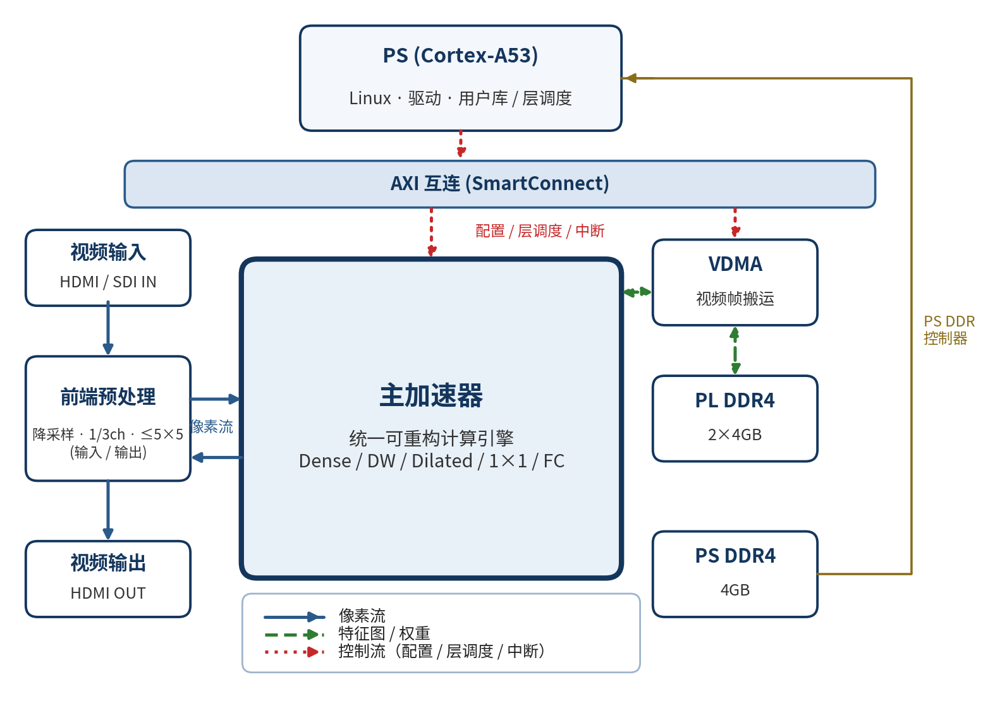

# 多功能图像处理模型 FPGA 加速器 — 完整实施计划

> 目标板：iW-RainboW-G35D（XCZU19EG-2） · 实现语言：SystemVerilog · 流程：Xilinx 全命令行
>
> 本文档是计划 v3.1 的 Markdown 版（与 12 页 A4 PDF 同内容）。PDF 为生成物，不进版本库。

## 系统框图

框图说明：

- **主加速器位于系统中央，是唯一的计算核心**，图中居中、最大块、加粗边框：统一可重构计算引擎，Dense / DW / Dilated / 1×1 / FC。
- **视频流从左侧进入**：视频输入（HDMI / SDI IN）→ 前端预处理（降采样、1/3ch、≤5×5，输入/输出）→ 主加速器 → 前端 → 视频输出（HDMI OUT）。
- **特征图与权重**经 VDMA（视频帧搬运）在 PL DDR4（2×4GB）与加速器之间搬运；PS DDR4（4GB）接 PS。
- **PS（Cortex-A53）**：Linux · 驱动 · 用户库 / 层调度，经 AXI 互连（SmartConnect）下发配置、层调度与中断。
- 图例：实线箭头为像素流；绿色虚线箭头为特征图 / 权重；红色点线箭头为控制流（配置 / 层调度 / 中断）。
- 前端预处理模块是整个模型的输入 / 输出接口。

## §1 调研结果

调研覆盖图像去噪、超分辨率、低光照增强、通用图像恢复、弱小目标检测五个领域，另校准目标检测（YOLO）与大核 CNN 文献。结论先行：dense 上限 9×9；大核全是 DW/条带/空洞；通道主流 64ch、瓶颈 256–512ch；IRSTD 最大 dense 仅 7×7。

### 1.1 图像去噪

**表 R1 图像去噪**

| 论文（年份） | 最大核 | 类型 | 通道 / 备注 |
|---|---|---|---|
| DnCNN (2017) | 3×3 | dense | 64ch；17 层（感受野 35×35）；无 pooling |
| FFDNet (2018) | 3×3 | dense | 64ch（灰度）/ 96ch（RGB）；可逆下采样 ×2 |
| RIDNet (2019) | 3×3 | dense (+1×1) | 64ch；EAM 用空洞卷积（存储核仍 3×3） |
| NAFNet (2022) | 3×3 | DW (+1×1) | base 32ch → 瓶颈 512ch；U-Net |
| Restormer (2022) | 3×3 | DW (+1×1) | base 48ch → 384ch；U-Net |

去噪是 3×3 的世界：感受野靠深度（17–20 层）与下采样，不靠核尺寸；无 pooling。

### 1.2 超分辨率

**表 R2 经典 CNN 超分**

| 论文（年份） | 最大核 | 类型 | 通道 / 备注 |
|---|---|---|---|
| SRCNN (2014) | 9×9 | dense | 9-1-5：9×9（3→64）、1×1、5×5；SR 最大 dense |
| FSRCNN (2016) | 5×5 | dense | 5×5 + 薄层；末端反卷积上采样 |
| VDSR (2016) | 3×3 | dense | 20 层 × 3×3，64ch，全局残差 |
| SRResNet (2017) | 9×9 | dense | 9×9 输入/输出；16 残差块全 3×3，64ch；pixel-shuffle ×4 |
| EDSR (2017) | 3×3 | dense | baseline 16 块/64ch；最终 32 块/256ch（最宽 dense 体） |
| RCAN (2018) | 3×3 | dense | 64ch；通道注意力用 1×1 |

**表 R3 Transformer 超分**

| 论文（年份） | 最大卷积核 | 类型 | 窗口 / 通道 |
|---|---|---|---|
| SwinIR (2021) | 3×3 | dense | 窗口 8×8；180ch 经典 / 60ch 轻量；pixel-shuffle |
| HAT (2023) | 3×3 | dense | 窗口 16×16；180ch（HAT-S 144）；重叠交叉注意力 |
| SRFormer (2023) | 3×3 | dense | 窗口 24×24（注意力窗口，非卷积核）；pixel-shuffle |
| DAT (2023) | 3×3 | DW | 3×3 DW（SGFN）；180ch 家族 |

Transformer SR 靠注意力窗口（8→16→24）买长程，卷积不超过 3×3。

**表 R4 大核超分**

| 论文（年份） | 最大核（存储） | 等效 | 类型 | 通道 |
|---|---|---|---|---|
| PLKSR (2024) | 17×17 | 17 | DW，部分（16/64ch） | 64ch |
| LKMN (2025) | 31（条带） | 31 | DW 条带 31×1+1×31，部分 | 36ch / 64ch |
| LKFMixer (2025) | 31（条带） | 31 | DW 条带，部分（α=0.25）；>31 性能下降 | 36/64ch 家族 |
| ESC (2025) | 13×13 | 13 | dense 16→16 共享，仅 16ch | 16ch 大核子集 |
| SeemoRe (2024) | 11×11 | 11 | DW 条带 | 36ch / 48ch |
| MAN (2024) | 9×9（存储） | 35 | DW + DW 空洞（d=4） | — |
| ALKDNet (2024) | 9（条带） | 9 | 条带 9×1+1×9；11 无增益 | 64ch |
| EchoSR (2026) | 17×17 | 17 | DW | — |

SR 最大核是 31（DW 条带，LKMN/LKFMixer）；最大方形存储核是 17×17 DW（PLKSR/EchoSR）；最大 dense 是 9×9（SRCNN/SRResNet）。

### 1.3 低光照增强

**表 R5 低光照增强**

| 论文（年份） | 最大核 | 类型 | 通道 / 备注 |
|---|---|---|---|
| RetinexNet (2018) | 9×9 | dense | Decom-Net 首层 9×9（4ch→64）；其余 3×3 |
| EnlightenGAN (2021) | 3×3 | dense | 注意力 U-Net：32→512；判别器 4×4 stride 2 |
| Zero-DCE (2020) | 3×3 | dense | 7 层全 3×3，32ch；末层 tanh |
| Zero-DCE++ (2020) | 3×3 | DW (+1×1) | 3×3 DW + 1×1，32ch |

低光照是 3×3，只有 RetinexNet 首层一个 9×9 dense；其余 3×3。

### 1.4 通用图像恢复

**表 R6 通用图像恢复**

| 论文（年份） | 最大核 | 类型 | 通道 / 备注 |
|---|---|---|---|
| MPRNet (2021) | 3×3 | dense | 40/80/96ch（任务相关）；U-Net |
| HINet (2021) | 4×4（下采样卷积） | dense | 3×3 首/末；2×2 转置卷积上采样 |
| LaKDNet (2023) | 9×9 | DW (+1×1) | 9×9 去焦 / 7×7 运动；32/48ch → 瓶颈 256/384ch |
| LKD-Net (2023) | 21（等效） | DW 分解 | 21×21 DW 分解为小 DW + DW 空洞 |
| OKNet (2024) | 63×63 | DW（+条带） | 仅 bottleneck；去雾/去雪/去焦模糊 |
| UIR-PolyKernel (2024) | 31×31 | DW（+条带） | 瓶颈（1/4 分辨率）；试过 63 选 31 |

恢复最大 63×63 DW 仅 bottleneck（OKNet），是孤例；其余 ≤21（等效）。

### 1.5 目标检测（YOLO）

最大核 7×7：YOLOv12 的 Position Perceiver 用 7×7 depthwise 可分离卷积（消融到 9×9 后变慢、定为 7×7）；YOLOv1 首层 7×7 stride 2；YOLOv2/v3/v5/v8/v11 只用 3×3 与 1×1。现有 9×9 已覆盖全部 YOLO；YOLOv12 的 7×7 是 depthwise，不是 dense。

### 1.6 通道数

**表 R7 通道数**

| 类别 | 典型特征通道 | 备注 |
|---|---|---|
| 输入 / 输出 | RGB 3ch（灰度 1ch） | 少数 4ch 输入（RetinexNet、EnlightenGAN）；SR pixel-shuffle 头输出 3·s²ch |
| 去噪（DnCNN/FFDNet/RIDNet） | 64（FFDNet RGB：96） | — |
| 低光照（Zero-DCE/RetinexNet） | 32–64 | — |
| 经典 SR（SRCNN/VDSR/SRResNet/RCAN） | 64 | EDSR 除外 |
| EDSR（最终模型） | 256 | 最宽 dense 体（baseline 64） |
| 轻量 SR（SeemoRe/LKMN/PLKSR） | 36–64 | 大核只作用于 16ch 或前 1/4 通道 |
| Transformer SR（SwinIR/HAT） | 180（HAT-S 144） | 需 tile 到 192 |
| U 形恢复 base | 32–48 | NAFNet 32；Restormer/LaKDNet 48 |
| U 形恢复 bottleneck | 256–512 | NAFNet 512；Restormer 384；EnlightenGAN 512 |

大核 DW 只作用于少数通道（PLKSR 16/64ch；ESC 16ch；LKMN/LKFMixer 前 1/4 通道）。

### 1.7 除卷积外的算子

**表 R8 除卷积外的算子**

| 算子 | 在哪些模型里用 |
|---|---|
| 1×1 卷积 | SRCNN（9-1-5）；NAFNet/Restormer（1×1 → 3×3 DW）；RCAN 通道注意力（1×1） |
| pixel-shuffle | SRResNet、SwinIR、EDSR（SR 上采样 ×4） |
| 残差加法 | VDSR（全局残差）；SRResNet/EDSR/RCAN（残差块）；DnCNN（残差学习） |
| pooling / 下采样 | stride-2 卷积、pixel-unshuffle、max-pool（下采样）；GAP（通道注意力） |
| 激活 | ReLU（通用）；GELU（Transformer SR）；tanh（Zero-DCE 末层）；sigmoid（门控/注意力） |
| 归一化 | BatchNorm（CNN）；LayerNorm（Restormer/NAFNet） |
| 逐元素 | SimpleGate（NAFNet，通道对半乘）；门控/注意力缩放 |
| 上采样 | pixel-shuffle；转置卷积（FSRCNN、HINet）；最近邻/双线性 |

### 1.8 弱小目标检测（红外弱小目标检测 IRSTD）

目标典型 3×3–9×9 px，约占图像面积 0.01%（SDS-Net）；近两年（2024–2026）工作为主。

**表 R9 弱小目标检测**

| 论文（年份） | 最大核 | 类型 | 通道 | 其他算子 / 设计要点 |
|---|---|---|---|---|
| SDS-Net (2025) | 21 条带（1×21+21×1）；7×7 dense | 条带 + dense | 32→64→128→128 | MSCA/MSSA 注意力、MDFA、ADSF 融合 |
| LCRNet (2024) | 7×7 等效（11×11 试过更差） | 分解 DW + 空洞 DW + 1×1 | 16→32→64→64 | DLC-Attention、C2FBlock |
| RDIAN (2023) | 7×7 dense；空洞等效 17 | dense 多尺度 + 空洞 | 16→32 | CBAM、8 方向卷积 |
| SWAN (2025) | 5×5 DW | DW + Haar 小波 | 32→64→128→256→512 | Haar 小波卷积、移窗注意力 |
| SCTransNet (2024) | 5×5 DW | DW + 1×1 | base 32 | 跨层 Transformer 注意力 |
| SeRankDet (2024) | 3×3 空洞（等效 9） | dense + 差分 + 空洞 | 64→128→256→512→1024 | Top-K 注意力、LSFF 融合 |
| PConv (2025) | 1×3/3×1（等效感受野 25） | 非对称 pinwheel | YOLOv8n-p2 宿主 | SD Loss；高斯形先验 |
| MSHNet (2024) | 3×3 | dense | 未确认 | SLS loss；普通 3×3 U-Net + 更好 loss |

IRSTD 最大 dense 仅 7×7（RDIAN、SDS-Net）；最大条带 21（SDS-Net 1×21+21×1）；最大空洞等效 17（RDIAN 3×3、d=8）；无 17×17/31×31 DW/条带（31×31 DW 只在红外超分 LKFormer 里，不算检测）。通道近年更窄更轻（LCRNet 16→32→64→64，SDS-Net 32→64→128→128）。2024–26 的精度增益不在核尺寸：RFONet（2026）仅用 3×3 就达 SOTA（靠 ERF 排序），MSHNet 普通 3×3 U-Net + 更好 loss；更大核反而可能有害（LCRNet 11×11 等效比 7×7 差 1.73 IoU）。

### 调研结论

Dense 上限 9×9（SRCNN、SRResNet、RetinexNet 首层）；27×27 dense 无依据。大核全是 DW/条带/空洞：SR 最大 31（DW 条带）、方形最大 17×17 DW；恢复最大 63×63 DW 仅 bottleneck（孤例）。弱小目标检测（IRSTD）最大 dense 仅 7×7、最大条带 21、空洞等效 17，通道更窄更轻；2024–26 的增益在 loss/先验/动态核/小波/分辨率保持，不在核尺寸。通道主流 64ch、瓶颈 256–512ch；大核 DW 只作用于少数通道。层数多（DnCNN 17 层、EDSR 32 块、RCAN 200 RCAB），感受野靠深度。

## §2 设计需求

目标：一个能跑完整图像增强/恢复/超分模型的 FPGA 加速器（像素流水线 4K60 实时；完整多通道模型按 §3 的 roofline 给出可达工作点；上板验证）。本节每条需求都能从 §1 的调研结果追溯（括号内标注来源）。

### 2.1 架构需求

- **统一可重构计算引擎**：dense/DW/dilated/1×1/FC 五模式复用同一 MAC 阵列（PX=1/2/4 编译时参数化），层间分时复用。依据：模型层数多（DnCNN 17 层、EDSR 32 块、RCAN 200 RCAB，§1.1/§1.2）；每层单独建要 4896 DSP，超 ZU19EG 1968 上限（§5）。
- **模块复用（循环处理）为默认做法**：单引擎轮流跑各层；浅层模型（≤3–4 层，如 SRCNN）可用流式小 pipeline。依据：层数多 + DSP 上限（同上）。
- **存储层次与层融合**：寄存器/行缓存 → tile 缓存（64×64×64ch=256 KB）→ 权重缓存（双缓冲）→ PL DDR4 → PS DDR4；连续层融成一组，tile 在片上走多层，中间结果不上 DRAM。依据：不融合 DnCNN 1080p60 要 271 GB/s（§3），超 PL DDR4 理论峰值 38.4 GB/s。
- **共享 DRAM 访问架构**：AXI SmartConnect 仲裁；优先级 VDMA（实时视频）> 计算引擎（吞吐）> PS 控制（尽力而为）；地址分区；异步 FIFO；带宽分配。依据：计算引擎、VDMA、PS 三方访 DRAM；实时视频防下溢（§3）。
- **AXI 接口**：AXI4-Lite（控制/配置寄存器）、AXI4-Stream（像素流）、AXI4-MM（DDR 搬运）。依据：Xilinx IP 通用标准，便于系统集成。
- **前端视频预处理模块**：基于已冻结流式卷积衍生（SV），降采样、通道 1/3 可配、核 ≤5×5；是整个模型的输入/输出接口；轻量、延时最小。依据：输入/输出几乎都是 RGB 3ch 或灰度 1ch（§1.6），视频流需在接口处降采样与小核滤波。
- **空间分辨率可调 + 反比原则**：W/H 运行时可配；大核只出现在低分辨率，大核档用折叠/分时 datapath。依据：OKNet 63×63 只在 bottleneck、UIR-PolyKernel 31 在 1/4 分辨率、LKMN/LKFMixer 大核只作用于部分通道（§1.2/§1.4）。
- **通道 tiling**：C_in 分块累加、C_out 分块复制；64 lane 覆盖绝大多数 dense 层，128 宽裕；256–512ch 只在 bottleneck（低分辨率），分块跑。依据：通道数（§1.6）。
- **弱小目标检测（IRSTD）感受野已覆盖**：现有算子集（dense 11×11、DW 17×17/31 条带、dilated 等效 ≤35）已超过 IRSTD 全部已验证需求（最大 dense 7×7、最大条带 21、空洞等效 17，§1.8）；更大核反而可能有害（LCRNet 11×11 等效比 7×7 差 1.73 IoU）。

**表 1 存储层次**

| 层次 | 容量 | 放什么 | 带宽量级 |
|---|---|---|---|
| 寄存器/行缓存 | BRAM，K 行 | 滑动窗口（K 行 × W） | 片上，线速 |
| tile 缓存 | BRAM，256 KB–1 MB | 输入 tile（跨 C_out 复用）+ 输出 tile | 片上，线速 |
| 权重缓存 | BRAM，数十–数百 KB | 当前层权重（双缓冲） | 片上，线速 |
| PL DDR4 | 2×4GB | 特征图、权重、帧缓冲 | 理论 38.4 GB/s，实际约 27 GB/s（估算） |
| PS DDR4 | 4GB | 模型文件、帧缓冲、OS | 理论 19.2 GB/s，实际约 13 GB/s（估算） |

**表 2 PL DDR4 分区（规划值）**

| 区域 | 大小 | 说明 |
|---|---|---|
| 输入帧缓冲（乒乓） | 2 帧 | 4K RGB 一帧 24.9 MB |
| 输出帧缓冲（乒乓） | 2 帧 | 4K RGB 一帧 24.9 MB |
| 中间特征图暂存 | 按需 | 切分点落盘（1080p/64ch 每点 133 MB） |
| 权重区 | 按需 | 全模型权重（DnCNN 1.1 MB；EDSR-256 75.5 MB） |
| PS 共享区 | 预留 | 控制与状态 |

### AXI 接口（统一标准）

- **AXI4-Lite（控制/配置）**：走配置寄存器（核尺寸、stride、padding、通道数、tile 尺寸、启动/状态、中断）；32 位数据位宽；时钟为 PS-PL AXI 控制时钟（通常 100 MHz，XDC/Tcl 中定）。
- **AXI4-Stream（像素数据流）**：走像素流（前端 ↔ 计算引擎 ↔ VDMA/输出）；数据位宽 8×PX 位（PX=2 时 16 位，PX=4 时 32 位），TUSER（sof）、TLAST（eol/last）边带；时钟为处理时钟 300 MHz；valid/ready 背压。
- **AXI4 memory-mapped（DDR 搬运）**：走特征图与权重在 PL DDR4/PS DDR4 之间的搬运（引擎 tile 读写、VDMA 帧搬运、PS 模型加载）；数据位宽 64/128 位（按 MIG/HP 口配置）；时钟为存储/AXI 时钟域（经 MIG，XDC/Tcl 中定）；突发传输。

AXI 是 Xilinx IP 核的通用标准，无更通用的替代总线；Versal NoC 仍走 AXI 端口且仅 Versal 有，本板 Zynq UltraScale+ 用 AXI Interconnect/SmartConnect 互连。

### 前端视频预处理模块

位置在视频输入端（HDMI/SDI IN → 前端预处理 → VDMA → PL DDR → 主加速器）与输出端（主加速器 → PL DDR → VDMA → 前端 → HDMI OUT），是整个模型的输入/输出接口；它在像素流上 inline 处理，不经过 DRAM 往返。

数据流向：输入视频流（RGB 3ch 或灰度 1ch）经前端降采样与小核（≤5×5）滤波后进主加速器；主加速器输出经前端后处理后出 HDMI。前端与主加速器之间经 VDMA/PL DDR 衔接（帧级），前端内部为流式（行级），不引入帧缓冲。

延时预算：前端流水线延时 ≤ 数十周期（与原核 23 周期同量级）；行缓存等待约 (K−1) 行（5×5 核约 4 行），4K60 下约 26 µs，不到一帧的 0.2%，不构成瓶颈。

来源与规格：基于已冻结的原版流式卷积（Verilog 1px/2px，`~/workspace/fpga-2d-conv/`）的设计衍生；原版 RTL 冻结不动、不修改；预处理模块是以后基于它衍生的独立模块，用 SystemVerilog 写。规格：降采样（2×/4×，stride 卷积下采样，配置可选）；输入/输出通道可配为 1（灰度）或 3（RGB）；核尺寸最大 5×5（比主加速器小，轻量）；PX=1/2 参数化；8 位像素、16 位系数；移位+饱和输出（沿用已有结构）。只用 25 乘法器/lane（5×5）与 4 个行缓存（K−1=4），DSP 25×PX（PX=2 时 50，约 3%）。

### 2.2 算子集需求

**表 OP 算子集需求**

| 算子 | 规格 | 需要它的模型 / 论文 | 实现 / 资源 |
|---|---|---|---|
| Dense 卷积 | 最大 11×11 | SRCNN/SRResNet/RetinexNet 首层用 9×9 dense（文献 dense 上限，§1.2/§1.3），留一档余量到 11 | 121 乘法器/lane；32 位累加器 |
| DW 方核 | 17×17 | PLKSR/EchoSR 用 17×17 DW（SR 最大方形存储核，§1.2） | 289 乘法器/lane；只作用于部分通道 |
| DW 条带 | 31×1 / 1×31 | LKMN/LKFMixer 用 31 条带（SR 最大核，§1.2） | 31 乘法器/方向 |
| Dilated DW | 存储核 3–9、d≤4、等效 ≤35 | MAN/VAN/LKA（等效 35/21，§1.2） | 抽头间距可配；不加大窗口 |
| 1×1 pointwise | 1×1 | SRCNN 1×1；NAFNet/Restormer 1×1；RCAN 通道注意力 1×1（§1.1/§1.2） | 复用 dense datapath（K=1） |
| FC | 全连接 | 检测/分类头（YOLO，§1.5）与通用全连接层 | 复用 1×1 MAC 阵列（H=W=1） |
| Pooling | max/avg 2×2、GAP | 下采样（stride-2 卷积、pixel-unshuffle、max-pool，§1.1/§1.4）；GAP 用于通道注意力 | 比较器/加法树；无 DSP |
| 激活 | ReLU/Leaky/GELU/sigmoid/tanh | ReLU 通用；GELU（Transformer SR，§1.2）；tanh（Zero-DCE 末层，§1.3）；sigmoid（门控/注意力） | ReLU 零成本；PWL 近似（sigmoid/tanh/GELU） |
| 归一化 | BatchNorm/LayerNorm | BatchNorm（CNN，折叠进卷积系数）；LayerNorm（Restormer/NAFNet，§1.1） | BatchNorm 无硬件；LayerNorm 专用单元 |
| 逐元素 | 残差加法/乘/拼接 | 残差加法（VDSR/SRResNet/EDSR/RCAN/DnCNN，§1.1/§1.2）；拼接（U-Net 跳连：NAFNet/Restormer/MPRNet，§1.1/§1.4）；乘（SimpleGate，NAFNet，§1.1） | 加法器/小乘法阵列；拼接纯搬运 |
| 上采样 | pixel-shuffle/最近邻/双线性/转置卷积 | pixel-shuffle（SRResNet/SwinIR/EDSR，§1.2）；转置卷积（FSRCNN、HINet，§1.2/§1.4） | 通道-空间重排；转置卷积复用卷积阵列 |

### 不做（明确边界）

- Transformer 注意力（SwinIR/HAT 的 attention 窗口）不在 PL 做；只做卷积类算子。
- 训练与量化感知训练；只做推理，系数离线量化后加载。
- Dense 27×27（729 乘法器/输出/通道，文献里没有，不做）。
- 浮点；全定点。
- 不做通用 NPU/可编程指令集；做专用可重构加速器 + 运行时可配参数 + 层表驱动的配置序列。
- 不再用 Verilog 写新模块：全部实现一律 SystemVerilog；原版 Verilog 流式卷积已冻结，只作参考基线，不修改；预处理模块以后实现时也用 SV 写。
- IRSTD 2024–26 的增益点（loss 设计、目标/背景先验、动态核与注意力、Haar 小波/频域、ERF 排序、非卷积上下文）不在卷积引擎规格内；分辨率保持是系统级要求：前端预处理与层切分不要对小目标做激进下采样（一般不超过 1/16，不做到 1/32），保留高分辨率浅层分支。

## §3 带宽分析与模型切分

### 3.1 屋顶（roofline）

- **算力屋顶**：1968 DSP × 300 MHz = 590 GMAC/s 峰值；实际约 70% 即 413 GMAC/s（估算，含利用率与流水线开销）。
- **DRAM 屋顶**：PL DDR4 双通道 DDR4-2400，理论 2×19.2=38.4 GB/s，实际约 27 GB/s（估算，以板子手册为准）；PS DDR4 单通道理论 19.2 GB/s，实际约 13 GB/s（估算）。
- **结论**：算力是瓶颈（多通道模型）；DRAM 带宽在融合后很宽裕。

### 3.2 不融合的代价

**表 4 每层 DRAM 往返带宽（读入 + 写出）**

| 场景（每层，读入 + 写出） | 每层带宽 |
|---|---|
| 4K60 / 64ch | 63.7 GB/s |
| 1080p60 / 64ch | 15.9 GB/s |
| 1080p30 / 64ch | 8.0 GB/s |
| 720p30 / 64ch | 3.5 GB/s |
| 960×540（×4 SR 输入）/ 256ch / 60 fps | 15.9 GB/s |
| 480p30 / 64ch | 1.2 GB/s |

**表 5 DnCNN 17 层不融合总量**

| DnCNN 17 层不融合总量 | DRAM 带宽 |
|---|---|
| 1080p60 | 271 GB/s |
| 1080p30 | 135 GB/s |
| 720p30 | 60 GB/s |
| 480p30 | 20 GB/s |

结论：不融合在 1080p60 下要 271 GB/s，约 7 倍于 PL DDR4 理论峰值 38.4 GB/s，不可能；必须融合。480p30 下不融合总量 20 GB/s 已在实际带宽内，低分辨率可少融合。

### 3.3 融合后的带宽

**表 6 融合后 DRAM 流量（GB/s）**

| 场景（融合后） | 输入 | 输出 | 权重 | 合计 |
|---|---|---|---|---|
| DnCNN 1080p60 | 0.37 | 0.37 | 0.07 | 0.81 GB/s |
| DnCNN 4K60 | 1.49 | 1.49 | 0.07 | 3.05 GB/s |
| EDSR-256 ×4 SR（输入 960×540，输出 4K）60 fps | 0.09 | 1.49 | 4.5 | 6.2 GB/s |

结论：融合把 DRAM 流量降约 300 倍（271 → 0.81 GB/s，1080p60）；大模型权重流（EDSR-256 每帧 75.5 MB，60 fps 下 4.5 GB/s）是融合后最大的 DRAM 流量；融合后总量远低于 27 GB/s 实际带宽。

### 3.4 模型算力与可达工作点

**表 7 模型算力与帧率（峰值算力 590 GMAC/s；括号内为按 70% 实际算力 413 GMAC/s）**

| 模型 | 1080p | 720p | 480p |
|---|---|---|---|
| SRCNN（3 层） | 143 GMACs 4.1 fps（2.9） | 63.7 GMACs 9.3 fps（6.5） | 21.2 GMACs 27.8 fps（19.5） |
| DnCNN（17 层，64ch） | 1154 GMACs 0.51 fps（0.36） | 513 GMACs 1.15 fps（0.81） | 171 GMACs 3.45 fps（2.4） |
| EDSR-base（16 块，64ch） | 2450 GMACs 0.24 fps（0.17） | 1089 GMACs 0.54 fps（0.38） | 363 GMACs 1.63 fps（1.1） |
| EDSR-base ×4 SR（body 在 960×540） | 612 GMACs 0.96 fps（0.67） | — | — |
| EDSR-256 ×4 SR（body 在 960×540） | 19569 GMACs 0.03 fps | — | — |
| 单层 64ch 3×3（参考） | 76.4 GMACs 7.7 fps（5.4） | 34.0 GMACs 17.4 fps（12.2） | 11.3 GMACs 52 fps（36） |

结论：像素流水线（单通道/少通道）4K60；浅层模型（SRCNN）480p 接近 30 fps（峰值约 28 fps，实际约 20 fps）；深层模型（DnCNN）480p 约 3.5 fps、1080p 约 0.5 fps，离线速率；EDSR-256 不可实时。完整多通道模型在 HD 下达不到实时，这是算力屋顶的硬约束，不是实现问题。

### 3.5 切分方法（四步决策流程）

1. 算模型总 MACs/帧与目标 fps → 所需 MAC 吞吐 → 所需 DSP；超预算则降分辨率/帧率或简化模型（减通道/减层）。
2. 按融合规则定切分点：能放进片上 tile 缓存的连续层融成一组；分辨率变化处（下采样/上采样边界）、跳连（U-Net）处切开。
3. 核对每组片上缓存（tile 缓存 + 行缓存 + 权重缓存 ≤ BRAM 预算）与 DRAM 总量（≤ 27 GB/s 实际带宽）。
4. 选流式/循环/混合（见 3.6）。

### 3.6 流式 vs 循环 vs 混合

- **流式（层流水线，多引擎）**：浅层模型（≤3–4 层，如 SRCNN）或模型的 stem/tail；每层一个引擎，层间经小 FIFO/行缓存直连，中间不上 DRAM；吞吐高、延迟低；资源 = 各引擎之和；只在引擎数少时可行。
- **循环（单引擎，分时复用）**：深层模型（DnCNN 17 层、EDSR 32+ 块）；一套引擎轮流跑各层；资源最小（1 套），吞吐 = 单引擎吞吐 / 层数；默认做法。
- **混合**：按切分点分组，组内流式（2–4 层融成小 pipeline，tile 在片上走多层）、组间循环（引擎在各组之间切换，组间中间结果落 DRAM）；切分点数量受分辨率和帧率硬约束（见 3.7）。

### 3.7 切分点数量的硬约束

- 每切分点带宽（写出 + 读入）：1080p60/64ch 每点 16.0 GB/s；720p30/64ch 每点 3.5 GB/s；480p30/64ch 每点 1.2 GB/s。
- PL DDR4 实际约 27 GB/s，扣掉 VDMA（4K60 输入+输出约 3.0 GB/s）与权重（小模型可忽略），留给切分点约 24 GB/s。
- 允许切分点数：1080p60/64ch 最多 1 个（16 GB/s），2 个（32 GB/s）超预算；720p30/64ch 约 6 个；480p30/64ch 约 20 个（17 层全切开也够）。

结论：高分辨率/高帧率下只能少切（深融合），低分辨率下可多切；切分自由度随分辨率下降而增大。

### 3.8 切分示例

- SRCNN（3 层）：流式，3 个小引擎 pipeline，全程片上，零 DRAM 中间流量；1080p 约 4 fps、720p 约 9 fps、480p 约 28 fps（峰值）。
- DnCNN（17 层，64ch）：循环，单引擎；1080p60 下最多 1 个切分点（近全融合），480p30 下可全切；480p 约 3.5 fps、1080p 约 0.5 fps（峰值）。
- EDSR-base ×4 SR：body 在 960×540，循环；约 1 fps 到 4K（峰值）。

## §4 实现阶段与里程碑

分两个大阶段，以回匹兹堡 11/26 为界。阶段 0 基线固化已完成：SV 参数化 PX=1/2/4，dense 9×9，golden+STA+资源已验证；交付物为现有代码与两份 4 页报告。

### 第一阶段 — VM 上：模块设计 + 单独验证 + 模型数值验证

**表 8 第一阶段（阶段 1–7，VM 上）**

| 阶段 | 内容、验证与验收 |
|---|---|
| 阶段 1 Dense 扩到 11×11 + 任意 padding/stride（VM） | K 扩到 11，pad/stride 各边独立，输出尺寸公式，decimate。验证：golden 扩展（11×11、非对称 padding、stride 2/3），STA，资源。验收：golden 全过；Fmax 不低于 450 MHz（ASIC 模型，估算）；DSP 121×PX（精确计数）。 |
| 阶段 2 DW + 条带 + dilated（VM） | DW datapath（17×17 方核、31×1/1×31 条带、dilated 存储核 3–9/d≤4）。验证：golden（DW 各核、dilated 等效跨度），STA，资源。验收：golden 全过；DW 17×17 DSP 289×PX（估算）。 |
| 阶段 3 多通道 tiling + 1×1 + 残差 + pooling + 激活（VM） | C_in 分块累加、C_out 分块（串行换核先行，P_out 并行可选）、输入 tile 缓存、1×1 pointwise、残差加法、max/avg-pool、ReLU/Leaky ReLU（后处理链）。验证：多通道 golden（3/64ch）、pooling/激活 golden、端到端小模型（SRCNN 3 层或 DnCNN 片段）。验收：多通道输出像素精确，帧率达标。 |
| 阶段 4 其他算子 + 统一引擎 + 层调度器（VM） | FC（复用 1×1）、LayerNorm、逐元素乘、sigmoid/tanh/GELU（PWL LUT）、上采样（最近邻/双线性）、统一引擎重构（五模式一键切换）、层调度器（配置序列、权重双缓冲）。验证：各算子 golden、层切换 golden（连续两层配置切换无误）、权重双缓冲时序。验收：各算子 golden 全过；层切换正确。 |
| 阶段 5 层融合 + tile 调度 + 共享 DRAM 架构 + roofline/切分（VM） | 融合组与 tile 调度器、共享 DRAM 架构（仲裁、优先级、异步 FIFO、地址映射、带宽分配）、roofline 模型、SRCNN/DnCNN 切分点。验证：多层融合 golden（一个 tile 走多层、片上中间结果与 golden 一致）、DRAM 流量计数（仿真中统计 AXI 事务，与 §3 预算对照）、切分点验证。验收：融合输出像素精确；DRAM 流量在预算内；切分表完成。 |
| 阶段 6 模型数值验证（VM） | 端到端小模型（SRCNN 3 层、DnCNN 片段、RetinexNet Decom-Net）在 RTL 仿真中跑通，RTL 输出与 Python 模型 golden 逐像素比对，并给出每层误差预算。验收：模型数值验证通过（像素精确或误差在预算内）。 |
| 阶段 7 前端视频预处理模块（VM） | 基于已冻结原版流式卷积衍生（不改动原版 RTL）：降采样 2×/4×、通道 1/3 可配、核 ≤5×5、PX=1/2，SystemVerilog 实现。验证：golden（降采样、1/3ch、5×5）、STA、延时（行缓存等待约 4 行）。验收：golden 全过；流水线延时 ≤ 数十周期；原版 RTL 未改动。 |

### 第一阶段完成标准（什么算“做完”）

全部模块已设计并单独验证（golden PASS、STA、资源），至少一个端到端模型数值验证通过；代码、testbench、golden 模型、运行脚本、日志、报告全部进 git 并打 tag。

### 交接物（回匹兹堡时带走）

- RTL 源码（SystemVerilog 参数化）+ testbench + Python golden 模型 + 运行脚本；
- 验证日志（golden PASS、STA 报告、资源估算）；
- 模型数值验证证据（RTL vs Python 逐像素比对日志、每层误差）；
- 接口/配置规范（寄存器映射、AXI 接口、时序）；
- Tcl 脚本与 XDC（已写好，待 Vivado 机器上运行）；
- 层融合与切分表（SRCNN/DnCNN 切分点、融合组、tile 尺寸、DRAM 流量预算）；
- 共享 DRAM 架构文档（仲裁、优先级、地址映射、带宽分配）；
- 已知风险与假设清单（ASIC 模型 Fmax 与真实时序的差异、LUT 为推断值、Vivado 版本、DDR4 带宽为估算）；
- 前端视频预处理模块设计文档（规格：降采样、1/3 通道、≤5×5 核、SystemVerilog 实现、与主加速器的接口与延时预算）。

### 第二阶段 — 匹兹堡（11/26 后）：板级综合/集成/上板测试

**表 9 第二阶段（阶段 8–11，匹兹堡）**

| 阶段 | 内容与验收 |
|---|---|
| 阶段 8 板级综合与实现（Vivado） | 综合、布局布线、时序收敛、生成 bitstream（全命令行 Tcl）。验收：时序收敛，资源在预算内。 |
| 阶段 9 系统集成（AXI/VDMA/DDR/PS 驱动 + 共享 DRAM 架构上板） | AXI-Lite 配置、AXI-Stream、VDMA 帧搬运、PL DDR 特征图、PS 驱动与层调度库、共享 DRAM 仲裁上板、DRAM 流量实测；上板环路（HDMI IN → 处理 → HDMI OUT）。验收：上板 1080p60 实时；DRAM 流量与预算一致。 |
| 阶段 10 上板验证与模型跑通 | 完整模型上板（去噪、SR、RetinexNet），4K60（PX=2）或 1080p60，测帧率/功耗，时序收敛。验收：模型输出与 golden 比特一致（定点），帧率达标，时序收敛。 |
| 阶段 11 优化与收尾 | 瓶颈优化（桶形移位器再流水线化，Fmax 提升）、功耗、文档与报告更新。 |

## §5 资源预估与风险

资源（ZU19EG：522K LUT / 1968 DSP / 984 BRAM36 / 1045K FF；以下为估算，除注明外）：

**表 10 资源预估**

| 项目 | DSP | 其他资源与说明 |
|---|---|---|
| Dense 11×11 | 121×PX（精确计数：PX=1/2/4 → 121/242/484） | BRAM 10；LUT 约 9×9 的 1.5 倍（估算） |
| DW 17×17 | 289×PX（估算，全并行） | 实际只作用于部分通道（16ch 或 1/4），或折叠复用 dense datapath（0 额外 DSP，多拍） |
| 条带 31×1 | 31 乘法器/lane | 可忽略 |
| 多通道 | PX × C_par × K²（参数化） | 按预算选 tile；BRAM 随 tile 缓存增长，估算几十个 |
| tile 缓存（64×64×64ch） | 0 | 256 KB，约 57 BRAM36（按容量估算） |
| Pooling（max/avg/GAP） | 0–1 | 数十–数百 LUT（估算） |
| 激活（ReLU/Leaky/PWL） | 0–1/lane（PWL 插值） | 1 BRAM（PWL LUT）+ 数百 LUT（估算） |
| LayerNorm | 数个（估算） | 数百 LUT（估算） |
| 层调度器 + DRAM 仲裁 | 0 | 数百–数千 LUT + 异步 FIFO（数个 BRAM，估算） |

参考配置（估算）：PX=2、K=3 主流层、C_par=16 → DSP 288（15%）；K=11 档 C_par 降到 4 → DSP 968（49%）。整机典型占用估算：DSP 40–50%，LUT 6–10%，BRAM 8–15%（tile 缓存与权重缓存使 BRAM 高于原估计），均以 Vivado 综合为准。

复用对照：每层单独建模块（17 层 DnCNN，DSP 4896，超 1968 上限，不可行）；统一引擎 1 套（DSP 288，15%）+ 专用小单元（pooling/激活/归一化，DSP 0–数个，LUT 数百–数千）跑全部 17 层，分时复用。

DRAM 带宽需求：融合后 DnCNN 1080p60 约 0.81 GB/s、4K60 约 3.05 GB/s；EDSR-256 ×4 SR 约 6.2 GB/s；均远低于 PL DDR4 实际约 27 GB/s（估算）。切分点预算见 §3.7。

### 风险与对策

| 风险 | 说明与对策 |
|---|---|
| 算力不足（深层模型 HD 实时不可达） | §3 已量化：DnCNN 1080p 仅 0.51 fps（峰值）。对策：降分辨率/帧率、轻量模型（36ch）、离线处理；不把 HD 实时作为深层模型的验收标准。 |
| DDR 带宽 | 多通道大特征图往返 DDR 可能成瓶颈。对策：层融合 + tile 缓存复用（输入 tile 跨 C_out 复用）、切分点预算（§3.7）。 |
| 大通道 bottleneck 层（256–512ch） | 时间随通道数线性增长。对策：分块 + 低分辨率像素率低，仍可实时；必要时降 PX 或提时钟。 |
| 时序收敛 | 桶形移位器是瓶颈（ASIC 模型 2.09 ns），Vivado 下 Fmax 待实测；若不到 300 MHz，对策是移位器再流水线化（已有验证思路，ASIC 模型可到 600 MHz+）。 |
| 板级时序在回匹兹堡前未知 | Vivado 下 Fmax 待实测；若 VM 阶段验证不完整，板级工作顺延。对策：第一阶段完成标准与交接物清单就是为了防止这一点。 |
| Vivado 不在本机 | 综合/实现只能在有 Vivado 的机器上做。对策：全命令行 Tcl 脚本（§7），版本化，任意同版本 Vivado 机器可复现。 |
| 系数加载 | 大模型系数多（C_in×C_out×K²）；EDSR-256 权重 75.5 MB，每帧重载要 4.5 GB/s。对策：系数存 PL DDR，按需加载到片上；分层加载；权重双缓冲与计算重叠。 |
| 定点精度 | 量化误差累积。对策：每层 golden 对照（Python 浮点 vs 定点），误差预算。 |
| 层调度开销 | 层间切换（权重加载 + 寄存器配置）可能拖慢帧时间。对策：权重双缓冲与计算重叠；切换开销约 7 µs/层，相对毫秒级层计算可忽略（已在 §2 量化）。 |

## §6 投入与产出期望

投入（全职等效估算，实际日历时间取决于投入节奏）：

| 阶段 | 投入 |
|---|---|
| VM 阶段（阶段 1–7） | 约 11–14 周（全职等效） |
| 匹兹堡阶段（阶段 8–11） | 约 5–6 周（全职等效） |
| 合计 | 约 16–20 周 |

产出：

- 一个可跑完整图像增强/恢复/超分模型的 FPGA 加速器（像素流水线 4K60，完整模型按 §3 工作点），SystemVerilog 实现。
- 完整验证：golden（功能）、STA（时序）、上板实测（帧率/功耗/时序收敛）、DRAM 流量实测（与 §3 预算对照）。
- 可复现的全命令行流程（§7）与更新后的项目报告。

## §7 方法论与工具链：Xilinx 全命令行（不用 GUI）

原则：综合、实现、生成 bitstream、烧录/调试全部走 vivado batch / Tcl 脚本，不用 GUI；任何步骤都可单条命令复现。

### 目录与脚本结构

| 目录 / 文件 | 说明 |
|---|---|
| `fpga-accel/` | （本仓库根目录） |
| `rtl/` | SystemVerilog 源码（参数化） |
| `tb/` | testbench + golden（Python） |
| `scripts/` | Tcl 脚本 |
| `scripts/synth.tcl` | 综合（read_verilog -sv，synth_design，写 checkpoint + 利用率报告） |
| `scripts/impl.tcl` | 实现（place_design，route_design，时序报告） |
| `scripts/bitstream.tcl` | 生成 bitstream |
| `scripts/program.tcl` | 烧录（connect_hw_server，program_hw_device） |
| `scripts/debug.tcl` | ILA 抓取（create_hw_probe，run_hw_ila，导出波形） |
| `scripts/common.tcl` | 公共参数（器件、时钟、文件列表、版本号） |
| `constraints/` | XDC（时钟、引脚、时序约束） |
| `sw/` | PS 驱动 + 层调度库（C） |
| `Makefile` | 一键复现：make sim / synth / impl / bitstream / program |
| `logs/` | 每次运行的日志与报告（综合利用率、时序、功耗） |

版本管理：RTL + Tcl + XDC + 软件全部进 git；bitstream 与综合产物不进版本库（.gitignore），由脚本复现；每个里程碑打 tag；Tcl 脚本开头校验 Vivado 版本号并记录到日志。

复现方式：任意一台装有同版本 Vivado 的机器，git clone 后 make all 即可复现综合→实现→bitstream；仿真与 STA 在本 VM 用 Icarus/Yosys/OpenSTA 复现（已有流程）；上板验证用 make program + ILA Tcl 抓取，日志留档。

工具链：仿真/STA 在本 VM（Icarus 13.0、Yosys 0.52、OpenSTA 2.0.17、Python 3、Nangate45）；综合/实现/上板在 Vivado 机器（版本锁定，Tcl 校验）。

## 附：决策依据（文献）

Dense 最大 9×9（SRCNN、SRResNet、RetinexNet 首层）；SR 最大方核 17×17 DW（PLKSR）；条带 31（LKMN/LKFMixer）；恢复最大 63×63 DW 仅 bottleneck（OKNet）；dilated 存储核 ≤9、d≤4、等效 ≤35（MAN/VAN）。弱小目标检测（IRSTD）：最大 dense 7×7、最大条带 21、空洞等效 17；2024–26 增益在 loss/先验/动态核/小波/分辨率保持，不在核尺寸。

通道数：RGB 3ch；特征宽度主流 64ch；轻量 36–64ch；Transformer SR 180ch；EDSR 256ch；U 形恢复 bottleneck 256–512ch；64 lane 覆盖绝大多数 dense 层，128 宽裕。

算力与带宽依据：ZU19EG 1968 DSP × 300 MHz = 590 GMAC/s 峰值；PL DDR4 双通道 DDR4-2400 理论 38.4 GB/s、实际约 27 GB/s（估算）；特征图尺寸与帧率见 §3 各表，带宽数字由特征图尺寸、通道数、帧率算出。

**表 13 决策对照**

| 决策项 | 取值 | 文献依据 |
|---|---|---|
| Dense 最大核 | 文献 9×9；设计扩到 11×11 | SRCNN、SRResNet、RetinexNet 首层 |
| DW 最大方核 | 17×17 | PLKSR（SR） |
| DW 条带 | 31 | LKMN / LKFMixer |
| 恢复最大 DW | 63×63，仅 bottleneck | OKNet |
| IRSTD 最大核 | dense 7×7 / 条带 21 / 空洞等效 17 | SDS-Net、LCRNet、RDIAN |
| Dilated | 存储核 ≤9、d≤4、等效 ≤35 | MAN / VAN |
| 通道宽度 | 主流 64ch；bottleneck 256–512ch | 轻量 36–64ch；Transformer SR 180ch；EDSR 256ch |
| 模块复用 | 统一引擎分时复用，不每层单独建模块 | 17 层 DnCNN 单独建要 4896 DSP，超 1968 上限（§2） |
| 层融合 | 中间结果留片上，DRAM 只走输入/输出/权重 | 不融合 1080p60 要 271 GB/s，超 DDR4 峰值（§3） |
| 前端预处理 | 降采样 + 1/3ch + 核 ≤5×5；轻量，延时 ≤ 数十周期 | 基于已冻结原版流式卷积（9/9 golden、23 周期延时） |
